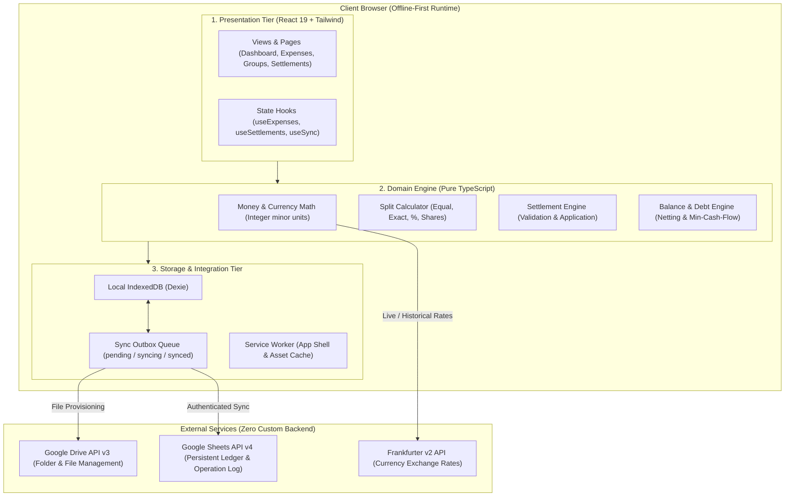
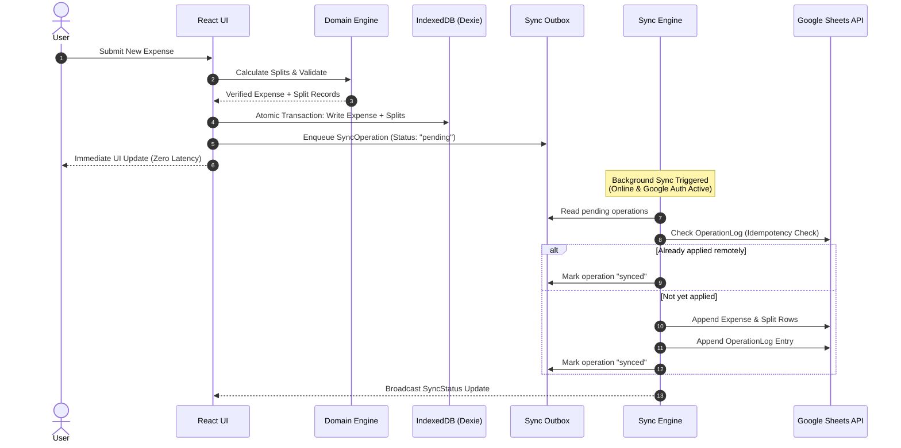
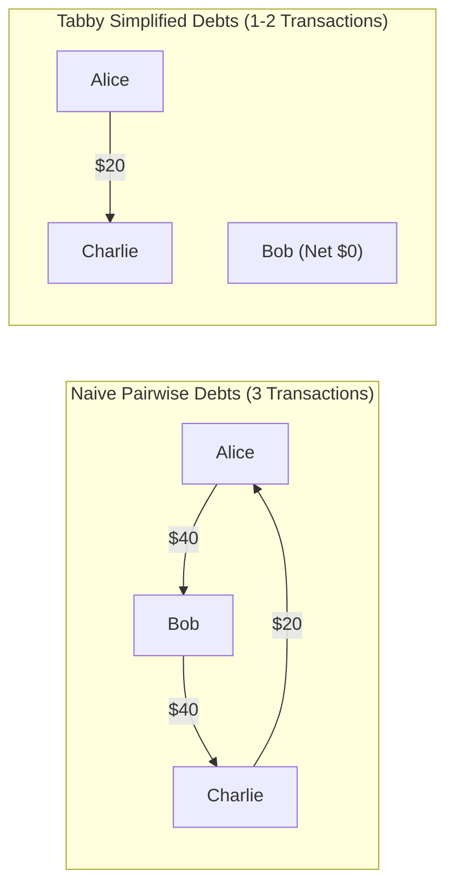

# Tabby Architecture & Engineering Specification

This document details the software architecture, data flow, accounting model, synchronization mechanics, and concurrency handling of **Tabby**, an offline-first expense splitting and personal finance web application with zero proprietary servers.

---

## 1. Architectural Philosophy

Tabby is built on three fundamental tenets:

1. **Local-First & Zero-Backend**: The client browser is the authoritative runtime. All financial calculations, split mathematics, and debt reductions execute client-side. The user's Google Drive and Google Sheets serve as an optional personal cloud storage backend without any intermediate proprietary database or proxy server.
2. **Financial Integrity & Integer Math**: Floating-point numbers are strictly prohibited for authoritative monetary calculations. All amounts are stored and calculated as integers in **minor currency units** (e.g., cents, pence, yen).
3. **Event-Sourced Settlement Accounting**: Settlements are recorded as distinct, immutable financial events. A debt payment never mutates, edits, or deletes the original expense record.



---

## 2. 3-Tier Layered Architecture

Tabby enforces strict separation of concerns across three distinct layers:

### Tier 1: UI / Presentation Layer
- **Framework & Routing**: React 19, TypeScript strict mode, React Router v7.
- **Styling & Components**: Tailwind CSS v4, shadcn/ui design primitives, Lucide React icons.
- **Data Visualization**: Recharts for monthly expenditure trends, category distributions, and group balance flows.
- **Form Management**: React Hook Form coupled with Zod schemas for input validation before touching domain logic.
- **State Management**: Reactive custom hooks (`useExpenses`, `useGroups`, `useSettlements`, `useSync`, `useAuth`, `useCurrency`, `useTheme`) backed by Dexie live queries and React context.

### Tier 2: Domain Engine Layer
The domain engine is **pure TypeScript with zero UI or browser DOM dependencies**. It is 100% unit-tested via Vitest.

- **Money Module (`src/domain/money/`)**:
  - ISO 4217 currency specifications with variable minor unit decimals (0 for `JPY`/`KRW`, 2 for `USD`/`EUR`/`GBP`, 3 for `BHD`/`KWD`/`OMR`).
  - Strict integer-only arithmetic.
  - Safe formatting functions for localization and non-authoritative UI display.
- **Splits Module (`src/domain/splits/`)**:
  - Implements four split strategies: `equal`, `exact`, `percentage` (using basis points: 10,000 = 100.00%), and `shares`.
  - Deterministic remainder distribution: residual pennies/cents from integer divisions are deterministically awarded penny-by-penny to the first $k$ participants so $\sum \text{shares} \equiv \text{total}$ without drift.
- **Settlement Module (`src/domain/settlements/`)**:
  - Validates and creates immutable settlement records.
  - Supports optional granular allocations mapping a payment directly to one or more expense IDs.
  - Implements pairwise balance reductions.
- **Balance & Debt Simplification Module (`src/domain/balances/`)**:
  - Computes net creditor/debtor positions across all participants.
  - Verifies the global zero-sum invariant: $\sum_{u \in U} \text{netBalance}(u) \equiv 0$.
  - Implements a greedy bipartite minimum cash-flow graph simplification algorithm to minimize total settlement transactions.

### Tier 3: Storage & Integration Layer
- **Local Storage (`src/storage/local/`)**:
  - IndexedDB managed via **Dexie.js** (`TabbyDatabase`).
  - 12 indexed tables: `users`, `groups`, `groupMemberships`, `expenses`, `expenseSplits`, `settlements`, `settlementAllocations`, `categories`, `syncOperations`, `exchangeRateCache`, `fileMetadata`, `syncCheckpoints`.
- **Sync Engine (`src/services/sync/`)**:
  - Persistent outbox queue pattern.
  - Online/offline network detection (`navigator.onLine` + heartbeat).
  - Mutexed write queues per Google Spreadsheet ID to serialize requests.
- **External Adapters (`src/services/`)**:
  - `GoogleAuthService`: Google Identity Services (GIS) token client with in-memory-only access token storage.
  - `GoogleDriveService`: Automated discovery and creation of the `Tabby` root folder and source spreadsheets.
  - `GoogleSheetsService`: Batch updates, row appends, and schema initialization.
  - `ExchangeRateService`: Frankfurter v2 rate fetching with multi-tier caching (Memory -> IndexedDB -> LocalStorage -> Static fallback).

---

## 3. Local-First Data Flow & Sync Pipeline

Tabby operates with an **optimistic, local-first write path**:



### The Outbox Mutation Lifecycle
Every mutating action (creating, updating, or soft-deleting an expense, settlement, group, or category) executes through the following deterministic cycle:

1. **Local Transaction**: The entity is saved to its primary Dexie table and assigned a UUIDv4 `id` and a unique `operationId`.
2. **Outbox Enqueue**: A corresponding `SyncOperation` record is written to `syncOperations` with `status: 'pending'`, `attemptCount: 0`, and the complete entity snapshot in `payload`.
3. **Trigger Evaluation**:
   - If offline or unauthenticated: The operation remains pending safely in IndexedDB.
   - If online and authenticated: The `SyncEngine` initiates processing.
4. **Per-Spreadsheet Mutual Exclusion**: Concurrent writes to the same spreadsheet are serialized through an in-memory promise queue (`queueSpreadsheetWrite`) to prevent out-of-order appends or Google Sheets rate bursts.
5. **Remote Idempotency Verification**: The engine checks the spreadsheet's `OperationLog` sheet for `operation.operationId`. If found, the remote spreadsheet already holds this mutation, and the local operation is immediately marked `'synced'`.
6. **Sheet Mutation**:
   - `create`: The entity is serialized to row columns and appended via `spreadsheets.values.append`. Associated child splits or allocations are appended to their respective sheets.
   - `update`: The target row is found via row-ID scan and overwritten via `spreadsheets.values.update`.
   - `delete`: Soft-deletion is executed by setting `deletedAt` timestamp on the target row.
7. **Audit Log Append**: An entry is appended to `OperationLog` containing `operationId`, `entityType`, `entityId`, `action`, `payloadJson`, `appliedAt`, and `userId`.
8. **Status Finalization**: The local outbox status transitions from `'syncing'` to `'synced'`.

---

## 4. Settlement Accounting Model

A foundational architectural requirement in Tabby is that **settlements are independent financial events; they never overwrite or mutate expense records**.

### Why Settlements Never Mutate Expenses

Traditional naive split apps often mark an expense as "paid" or modify its remaining balance column when a payment occurs. In Tabby, this practice is strictly rejected for the following structural reasons:

| Requirement | Overwriting Expenses (Anti-Pattern) | Independent Settlement Events (Tabby Architecture) |
| :--- | :--- | :--- |
| **Audit Trail & History** | Past expenses lose their original state; historical reconciliation is impossible. | Every payment has its own timestamp, note, currency, and receipt record. |
| **Partial Payments** | Requires complex split-mutation math on previous expense rows. | Debtor pays any arbitrary amount; the net balance reflects the reduction automatically. |
| **Multi-Expense Offsets** | A single $100 bank transfer covering 5 previous dinners cannot cleanly attach to a single expense row. | A single settlement pays down the gross debt between two parties regardless of expense count. |
| **Distributed Sync** | Modifying older expense rows causes merge conflicts across offline peers. | Appending a new settlement row is commutative and avoids conflicting row mutations. |

### Balance Derivation & Math Specification

The net financial position between any two users is derived by folding all active historical expenses and settlements:

1. **Gross Debt from Expenses**:
   For every non-deleted expense where User $A$ paid and User $B$ participated with share $S$:
   $$\text{GrossDebt}(B \to A) = \sum S$$

2. **Debt Offset from Settlements**:
   For every non-deleted settlement where User $B$ transferred amount $M$ to User $A$:
   $$\text{SettlementPaid}(B \to A) = \sum M$$

3. **Pairwise Net Balance**:
   $$\text{NetBalance}(B \to A) = \big(\text{GrossDebt}(B \to A) - \text{SettlementPaid}(B \to A)\big) - \big(\text{GrossDebt}(A \to B) - \text{SettlementPaid}(A \to B)\big)$$
   - If $\text{NetBalance}(B \to A) > 0$: User $B$ owes User $A$ the positive difference.
   - If $\text{NetBalance}(B \to A) < 0$: User $A$ owes User $B$ the absolute difference.
   - If $\text{NetBalance}(B \to A) = 0$: The pair is fully settled.

### Debt Simplification Algorithm (Minimum Cash Flow)

In a group of $N$ participants, naive pairwise debts can produce up to $N(N - 1) / 2$ separate transactions. Tabby includes an optimal greedy bipartite cash-flow simplification engine (`simplifyDebts` in `src/domain/balances/balance-engine.ts`) that guarantees settling all debts in **at most $N - 1$ transactions**:



**Algorithm Steps**:
1. Compute each participant's global net balance $B_u = \text{totalOwedToYou}(u) - \text{totalOwed}(u)$.
2. Partition into two lists:
   - **Debtors** ($B_u < 0$), sorted descending by debt magnitude $|B_u|$.
   - **Creditors** ($B_u > 0$), sorted descending by credit magnitude $B_u$.
3. Greedily match the largest debtor with the largest creditor:
   $$\text{TransferAmount} = \min(|B_{\text{debtor}}|, B_{\text{creditor}})$$
4. Record the simplified transfer from debtor to creditor.
5. Subtract $\text{TransferAmount}$ from both positions. Remove any settled party and re-sort.
6. Terminate when all debtors and creditors are settled.

---

## 5. Multi-Currency Engineering

Tabby provides institutional-grade multi-currency handling designed for international travel and cross-border groups:

### 1. Integer Minor Units Multiplier
Every currency is indexed in `CURRENCY_INFO` with its exact decimal places:
- **0 decimals** (Multiplier: $10^0 = 1$): `JPY`, `KRW`
- **2 decimals** (Multiplier: $10^2 = 100$): `USD`, `EUR`, `GBP`, `CAD`, `AUD`, `INR`, `SGD`, etc.
- **3 decimals** (Multiplier: $10^3 = 1000$): `BHD`, `KWD`, `OMR`

Conversion between major display and minor integer:
$$\text{minor} = \operatorname{round}(\text{major} \times 10^{\text{decimals}})$$
$$\text{major} = \frac{\text{minor}}{10^{\text{decimals}}}$$

### 2. Multi-Currency Conversion Math
When converting minor units from Currency $A$ to Currency $B$ with exchange rate $R$ (where $1 \text{ Unit of } A = R \text{ Units of } B$):
$$\text{convertedMinor} = \operatorname{round}\left(\frac{\text{amountMinor}_A \times R \times 10^{\text{decimals}_B}}{10^{\text{decimals}_A}}\right)$$

### 3. Historical Exchange Rate Snapshotting
Foreign exchange rates change second-by-second. If an app re-evaluates historical group balances using current live rates, yesterday's settled balances would retroactively shift, corrupting accounting records.

**Tabby Solution**: When an expense is recorded in a foreign currency, Tabby fetches the exchange rate for that exact transaction date via the **Frankfurter v2 API** (`https://api.frankfurter.dev/v2/rate/{BASE}/{QUOTE}?date={YYYY-MM-DD}`). The returned rate and conversion results are **permanently snapshotted** onto the `Expense` record:
- `originalAmountMinor` & `originalCurrency` (e.g., 5000 JPY)
- `reportingAmountMinor` & `reportingCurrency` (e.g., 3350 USD cents)
- `exchangeRate` (e.g., 0.0067)
- `exchangeRateDate` (e.g., `2026-10-15`)
- `exchangeRateSource` (`"frankfurter"`)

Future balance and report calculations use the immutable snapshot.

---

## 6. Sync Conflict Resolution & Google Sheets Constraints

Google Sheets is a highly accessible, user-owned persistent store, but it lacks traditional SQL row-level locking and ACID transactions. Tabby engineers around these constraints through specific design patterns:

### Serialized Spreadsheet Queues
To eliminate race conditions caused by concurrent background tasks mutating the same Google Sheet, `SyncEngine` maintains an in-memory queue keyed by `spreadsheetId`:
```typescript
private spreadsheetQueues: Map<string, Promise<any>> = new Map();
```
All read-modify-write tasks for a given sheet must wait for preceding tasks on that sheet to resolve.

### Idempotency via Operation Log
Each spreadsheet contains a dedicated `OperationLog` sheet with columns:
`['operationId', 'entityType', 'entityId', 'action', 'payloadJson', 'appliedAt', 'userId']`
Before applying any mutation, Tabby queries the `OperationLog` using `operationId`. If an operation was already logged (e.g. from a previous interrupted sync), it is skipped and marked synced locally without duplicating row entries.

### Conflict Detection & Resolution Matrix
When synchronizing changes between multiple offline devices:
- **Creates**: If a record with the same `id` already exists remotely, the sync engine compares the remote record with the incoming operation. If identical, it is reconciled as a no-op; if divergent, the newer UTC `updatedAt` timestamp wins (Last-Write-Wins), and the remote row is updated.
- **Updates**: Target rows are matched by their permanent UUID `id` column. The updated payload overwrites the row in place.
- **Deletes**: Deletes are non-destructive soft deletes (`deletedAt: ISO8601`). Soft-deleted records are retained in the sheet for auditability and tombstone propagation to other clients.

### Google Sheets API Limits & Boundaries
Developers and users should be aware of Google's API quotas:
- **Per-User Quota**: 60 requests per minute per user.
- **Batching & Buffering**: Tabby batches split appends and allocation appends into multi-row append requests to minimize API quota consumption.
- **Capacity**: A single Google Spreadsheet supports up to 10,000,000 cells. Tabby's schema uses ~15 columns per expense, comfortably supporting hundreds of thousands of transactions per group or personal ledger.

---

## 7. Progressive Web App (PWA) & Security Architecture

Tabby is built as an offline-first Progressive Web App:

1. **App Shell Architecture**:
   - `public/manifest.webmanifest` provides installation metadata, standalone display mode, `#0D9488` teal brand colors, and crisp SVG/PNG icons.
   - `public/sw.js` caches the application shell (`/`, `/index.html`, icons, manifests) and all fingerprinted assets in `/assets/`.
2. **Caching Strategy**:
   - **Static Bundles (`/assets/*`)**: Cache-First strategy. Bundles have content-hashed filenames generated by Vite and are immutable.
   - **Navigation Requests**: Network-First strategy with immediate offline fallback to cached `/index.html`, enabling seamless client-side SPA routing while completely disconnected.
   - **Public API (Frankfurter)**: Network-First strategy with runtime cache fallback.
3. **Strict Zero-Cache Security Policy**:
   The service worker contains explicit security exclusions:
   - **NEVER** caches any requests to `accounts.google.com`, `googleapis.com`, or OAuth token endpoints.
   - **NEVER** caches requests with an `Authorization` HTTP header.
   - Google OAuth tokens exist strictly in volatile browser memory; they are never written to `localStorage` or IndexedDB.
