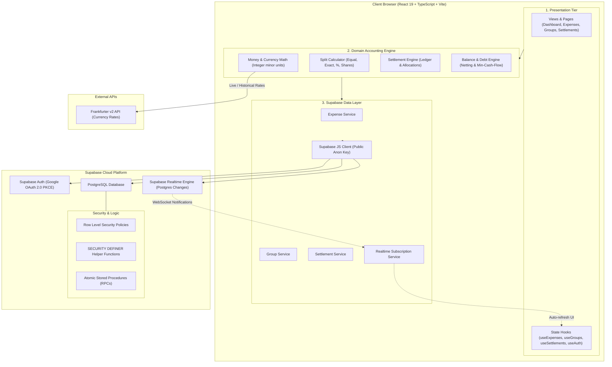
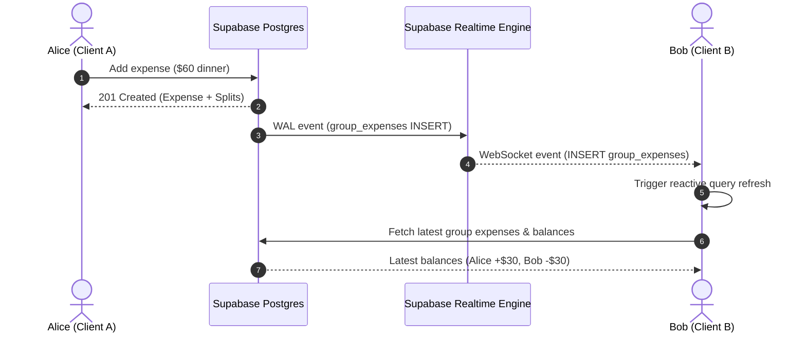

# Tabby Architecture & Engineering Specification

This document details the software architecture, database design, security model, accounting domain, and multi-user synchronization mechanics of **Tabby**, a modern multi-user expense splitting and personal finance web application built with **React, TypeScript, and Supabase**.

---

## 1. Architectural Philosophy

Tabby is built on four fundamental architectural tenets:

1. **Supabase PostgreSQL as Authoritative Single Source of Truth**:
   All financial records, group memberships, expense splits, settlements, and category assignments reside authoritatively in PostgreSQL. There are no offline write queues, no uncommitted local mutations masquerading as persisted data, and no spreadsheet sync layers. If a database write fails, the UI surfaces an error and allows the user to retry.

2. **Google Authentication via Supabase Auth**:
   Google is used strictly for secure user identity verification. No Google Drive or Google Sheets scopes or access tokens are requested or stored. Users authenticate via standard OAuth 2.0 PKCE / browser flows managed by Supabase Auth.

3. **Financial Integrity & Integer Math**:
   Floating-point arithmetic is strictly prohibited for authoritative monetary transactions. All currency amounts are stored and calculated as integers in **minor currency units** (e.g., cents, pence, yen). Split remainders are deterministically allocated without fractional balance drift.

4. **Row-Level Security (RLS) with Zero Trust**:
   Multi-tenancy and data privacy are enforced at the database layer via PostgreSQL Row Level Security. Clients authenticate with standard public/anon keys; PostgreSQL policies and non-recursive `SECURITY DEFINER` functions guarantee that users can never read, modify, or delete another user's private data or unrelated group expenses.

---

## 2. Technology Stack

| Layer | Technologies |
| :--- | :--- |
| **Runtime & Core** | React 19, TypeScript (Strict Mode), Vite 6 |
| **Styling & Components** | Tailwind CSS v4, Lucide React, Radix UI Primitives (shadcn/ui) |
| **Backend & Database** | Supabase PostgreSQL 15+, Supabase Row Level Security (RLS) |
| **Authentication** | Supabase Auth (Google OAuth 2.0 with PKCE) |
| **Multi-User Sync** | Supabase Realtime (WebSocket `postgres_changes`) |
| **Foreign Exchange** | Frankfurter v2 API with multi-tiered caching (Memory + PostgreSQL) |
| **Forms & Validation** | React Hook Form, Zod schema validation |
| **Visualization** | Recharts (Trends, category breakdowns, balance summaries) |
| **Quality & Tests** | Vitest, Testing Library, TypeScript Typechecking |

---

## 3. Database Schema Specification

All tables are defined in schema `public` with UUID primary keys and strict foreign key relationships:

### Core Tables

1. **`profiles`**:
   - `id UUID PRIMARY KEY REFERENCES auth.users(id) ON DELETE CASCADE`
   - `email TEXT NOT NULL`, `display_name TEXT`, `avatar_url TEXT`, `default_currency TEXT DEFAULT 'USD'`
   - Auto-provisioned via PostgreSQL trigger on `auth.users` creation.

2. **`groups`**:
   - `id UUID PRIMARY KEY DEFAULT gen_random_uuid()`
   - `name TEXT NOT NULL`, `description TEXT`, `currency TEXT NOT NULL DEFAULT 'USD'`, `simplify_debts BOOLEAN DEFAULT true`
   - `created_by UUID NOT NULL REFERENCES profiles(id)`
   - `created_at TIMESTAMPTZ`, `updated_at TIMESTAMPTZ`

3. **`group_members`**:
   - `id UUID PRIMARY KEY DEFAULT gen_random_uuid()`
   - `group_id UUID NOT NULL REFERENCES groups(id) ON DELETE CASCADE`
   - `user_id UUID NOT NULL REFERENCES profiles(id) ON DELETE CASCADE`
   - `role TEXT NOT NULL CHECK (role IN ('admin', 'member'))`
   - `joined_at TIMESTAMPTZ DEFAULT now()`
   - `UNIQUE(group_id, user_id)`

4. **`group_invitations`**:
   - Manages invitations by email for users joining existing groups.
   - `status TEXT CHECK (status IN ('pending', 'accepted', 'rejected', 'expired'))`

5. **`group_expenses`**:
   - `id UUID PRIMARY KEY DEFAULT gen_random_uuid()`
   - `group_id UUID NOT NULL REFERENCES groups(id) ON DELETE CASCADE`
   - `paid_by UUID NOT NULL REFERENCES profiles(id)`
   - `amount_cents BIGINT NOT NULL CHECK (amount_cents > 0)`
   - `currency TEXT NOT NULL`, `category_id UUID`, `date TIMESTAMPTZ NOT NULL`
   - `split_type TEXT NOT NULL CHECK (split_type IN ('equal', 'exact', 'percentage', 'shares'))`
   - `exchange_rate NUMERIC(14, 6) DEFAULT 1.0` (frozen rate at creation)
   - `created_by UUID NOT NULL REFERENCES profiles(id)`

6. **`expense_splits`**:
   - `id UUID PRIMARY KEY DEFAULT gen_random_uuid()`
   - `expense_id UUID NOT NULL REFERENCES group_expenses(id) ON DELETE CASCADE`
   - `user_id UUID NOT NULL REFERENCES profiles(id)`
   - `allocated_cents BIGINT NOT NULL CHECK (allocated_cents >= 0)`
   - `percentage_bp INTEGER`, `shares_count INTEGER`
   - `UNIQUE(expense_id, user_id)`

7. **`settlements`**:
   - Distinct, immutable debt transfers between two group members.
   - `id UUID PRIMARY KEY DEFAULT gen_random_uuid()`
   - `group_id UUID NOT NULL REFERENCES groups(id) ON DELETE CASCADE`
   - `payer_id UUID NOT NULL REFERENCES profiles(id)`
   - `payee_id UUID NOT NULL REFERENCES profiles(id)`
   - `amount_cents BIGINT NOT NULL CHECK (amount_cents > 0)`
   - `CHECK (payer_id <> payee_id)`

8. **`settlement_allocations`**:
   - Optional link between settlements and specific expenses for detailed receipt audit tracking.

9. **`personal_expenses`**:
   - Private personal finance tracking records visible only to the owning user.

10. **`currency_rates_cache`**:
    - Centralized cache of historical/daily exchange rates fetched from Frankfurter API v2.

---

## 4. Row Level Security (RLS) & Non-Recursive Security Model

PostgreSQL RLS ensures complete isolation between unrelated users and groups. To eliminate recursive policy evaluation issues, PostgreSQL `SECURITY DEFINER` functions execute membership lookups with restricted execution context:

### Security Helper Functions
- `public.is_group_member(group_id UUID, user_id UUID) RETURNS BOOLEAN`: Checks active membership in `group_members`.
- `public.can_admin_group(group_id UUID, user_id UUID) RETURNS BOOLEAN`: Validates `admin` role or group creator status.
- `public.is_expense_participant(expense_id UUID, user_id UUID) RETURNS BOOLEAN`: Verifies whether user is payer or split recipient.

### Security Invariants
- **Profile Isolation**: Users can update only their own profile (`id = auth.uid()`), while reading display names of users sharing a group.
- **Group Isolation**: Users can select, view, or participate only in groups where `is_group_member(id, auth.uid())` is true.
- **Financial Privacy**: Expenses, splits, and settlements are strictly inaccessible to any user not belonging to the associated group.
- **Audit Tamper Proofing**: Unauthenticated or unauthorized clients cannot mutate existing settlement records.

---

## 5. Atomic Stored Procedures (RPCs)

To guarantee transactional consistency when creating relational hierarchies, atomic PostgreSQL RPC functions are deployed:

1. **`create_group_with_owner(group_name, group_currency, group_description)`**:
   - Creates the group record.
   - Atomically inserts the calling user as the initial `admin` member in `group_members`.
   - Returns the created group model.

2. **`create_group_expense_with_splits(expense_data, splits_data)`**:
   - Verifies the creator and payer are authorized group members.
   - Inserts the expense header record into `group_expenses`.
   - Inserts all individual split items into `expense_splits`.
   - Asserts that $\sum \text{allocated\_cents} = \text{amount\_cents}$.
   - Executes in a single ACID transaction; any split mismatch automatically rolls back the entire operation.

3. **`accept_group_invitation(invitation_id)`**:
   - Validates pending status and caller's matching email.
   - Inserts the new member into `group_members`.
   - Updates invitation status to `accepted`.

---

## 6. Realtime Multi-User Notification Architecture

Tabby uses Supabase Realtime to push live changes across all active sessions and devices:

- When any group member records an expense or settlement, Supabase Realtime broadcasts change payloads on channel `group:<group_id>`.
- Client hooks (`useExpenses`, `useSettlements`, `useGroups`) subscribe to relevant group channels and automatically trigger server revalidation.
- Debounced refresh prevents duplicate queries when batched split records arrive.

---

## 7. Financial Accounting & Domain Calculations

### Integer Minor Units
To eliminate binary floating-point errors (e.g. `0.1 + 0.2 === 0.30000000000000004`), all internal representations and database columns store integer cents:
- \$12.50 is stored as `1250`.
- ¥1,000 is stored as `1000` (zero-decimal currency).
- Display formatting converts integer minor units to user-facing decimals at render time.

### Split Strategies
- **Equal**: Minor units divided evenly by $N$. Remainders $R = \text{Total} \pmod N$ are distributed to the first $R$ participants deterministically.
- **Exact Amounts**: Explicit per-person allocations; validator asserts $\sum \text{allocated} = \text{total}$.
- **Percentages**: Basis points ($10{,}000 = 100.00\%$) ensure precision.
- **Proportional Shares**: Fractional weightings computed and rounded to minor units.

### Greedy Debt Simplification
When enabled for a group, Tabby computes net balances for all members and runs a bipartite minimum-cash-flow algorithm:
1. Calculate net balance for each member: $\text{Net}_u = \sum \text{Paid}_u - \sum \text{Owed}_u$.
2. Separate into creditors ($\text{Net} > 0$) and debtors ($\text{Net} < 0$).
3. Greedily match maximum debtor with maximum creditor until all balances are zeroed, yielding at most $N - 1$ settlement transactions.

---

## 8. Currency & Foreign Exchange Architecture

- **Primary Source**: Frankfurter API v2 (`https://api.frankfurter.dev/v2/`).
- **Multi-Tiered Caching**:
  1. **L1 (In-Memory)**: Active session map for instant lookups during rapid form inputs.
  2. **L2 (PostgreSQL Cache)**: `currency_rates_cache` table shared across all group users, minimizing external API calls.
- **Rate Freezing**: When an expense is recorded in a foreign currency, the exact conversion rate is permanently recorded on the `group_expenses` record (`exchange_rate` column). Future fluctuations never alter historical debts.

---

## 9. Security & Deployment

- **API Keys**: Only `VITE_SUPABASE_URL` and the public `VITE_SUPABASE_PUBLISHABLE_KEY` (or `anon` key) are bundled in the frontend application. The `service_role` key is strictly excluded.
- **Service Worker / PWA**: The service worker caches static assets (HTML, CSS, JS, fonts) for instant loading, but explicitly bypasses caching for all Supabase API and WebSocket requests (`/rest/v1`, `/auth/v1`, `/realtime/v1`).
- **GitHub Pages Single Page App Routing**: Build output copies `dist/index.html` to `dist/404.html` and handles SPA client-side routing, enabling direct links and OAuth callback redirects (`/auth/callback`) to load without 404 errors.
