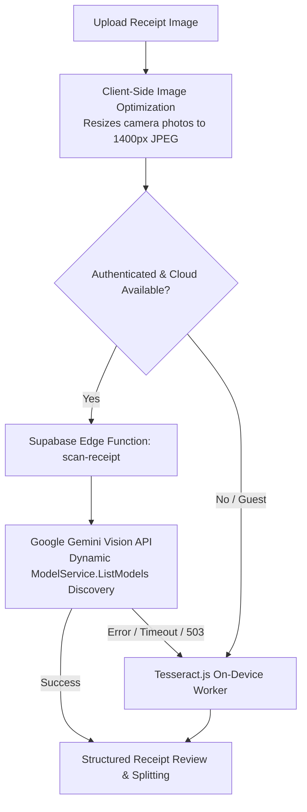
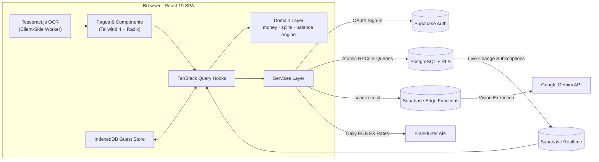

<div align="center">


# Tabby

**Split bills with friends, minus the awkward math.**

A Splitwise-style expense tracker for friends, flatmates, and trips, featuring multi-currency support and dual-engine receipt scanning.<br />
Built with React 19, TypeScript, Tailwind CSS 4, Supabase, and Google Gemini Vision.

[**Live Demo**](https://nikhil9182.github.io/Tabby/) · [Features](#features) · [Screenshots](#screenshots) · [Quick Start](#quick-start) · [Receipt Scanning](#receipt-scanning-architecture) · [Contributing](CONTRIBUTING.md) · [Architecture](#how-it-works)

[](LICENSE)
[](https://react.dev/)
[](https://www.typescriptlang.org/)
[](https://vite.dev/)
[](https://tailwindcss.com/)
[](https://supabase.com/)
[](https://vitest.dev/)

<br />

<p align="center">
  
</p>

</div>

---

## Why Tabby

Splitting costs sounds straightforward until someone pays in dollars, someone else in rupees, three people settle up a week later, and no one wants to manually type in a 15-item restaurant bill. Tabby keeps a running tab of who owes whom while keeping the underlying numbers mathematically exact:

- **Dual-Engine Receipt Scanning**: Cloud AI Vision extracts store names, line items, quantities, discounts, and taxes in seconds. When offline or in guest mode, it automatically falls back to local on-device OCR.
- **Zero Rounding Drift**: Money is stored strictly as integer minor units (cents, paise, yen). Fractional remainders are distributed deterministically so splits always equal the total down to the single cent.
- **True Multi-Currency**: A $50 debt remains a $50 debt. Display balances convert using daily European Central Bank exchange rates, but transaction ledgers never overwrite the original currency.
- **Offline Guest Mode**: Test and use the full application immediately without an account. Data persists in browser IndexedDB and smoothly merges into your account upon sign-in.
- **Privacy and Data Isolation**: Postgres Row-Level Security ensures users only access expenses they are explicit participants in. Backend Gemini API credentials are never bundled into client code.

---

## Screenshots

<div align="center">

### Receipt Scanning & Line-Item Splitting
*Extract restaurant receipts and assign individual dishes to specific friends.*

<p align="center">
  
</p>

<br />

### Mobile Layout & Spending Analytics
*Responsive on phone and desktop, with visual breakdowns of monthly spending.*

| Mobile View | Spending Reports & Analytics |
| :---: | :---: |
|  |  |

<br />

### Onboarding
*Start immediately in Guest Mode or sign in with Google OAuth.*

<p align="center">
  
</p>

</div>

---

## Features

| Feature | Description |
| :--- | :--- |
| **Receipt Scanner** | Upload or photograph a receipt. Cloud AI Vision extracts line items, discounts, and taxes with automatic on-device OCR fallback when offline. |
| **Smart Bill Splitting** | Split equally, by exact amounts, by percentages, by shares, or assign specific dishes to friends with proportional tax and tip distribution. |
| **Guest Mode** | Use Tabby immediately without signing up. Data lives in browser IndexedDB and merges into your cloud account when you sign in. |
| **Friends and Groups** | Keep 1-on-1 running tabs or create separate groups for trips, flatmates, and events without balances cross-contaminating. |
| **Debt Simplification** | Minimize the total number of bank transfers needed to settle a group using a greedy cash-flow settlement algorithm. |
| **Multi-Currency** | Record expenses in any currency and view balances converted at real-time exchange rates. Settle cross-currency debts with rate snapshots locked at payment time. |
| **Reports and Export** | View category distributions and spending trends over time, with one-click CSV and JSON data exports. |
| **Realtime Sync** | Multi-device sync powered by Supabase Realtime—updates appear instantly across devices without page reloads. |
| **Progressive Web App** | Installable as a standalone app on iOS, Android, macOS, and Windows with offline functionality. |
| **Row-Level Security** | Database-level isolation enforced by Postgres policies so users only ever see their own expenses. |

---

## Receipt Scanning Architecture

Tabby uses a hybrid receipt-processing pipeline designed to stay fast, resilient, and cost-effective:



1. **Client-Side Image Pre-Compression**: Camera photos (5MB–12MB) are resized to 1400px in browser memory before uploading, reducing payload size by ~97% and dropping scan latency from 60+ seconds to 1–2 seconds.
2. **Server-Side Security**: The Gemini API key resides solely in Supabase Edge Secrets and is never exposed in browser network bundles or storage.
3. **Dynamic Model Discovery**: The Edge Function dynamically discovers available Gemini models via Google's `ModelService.ListModels` API, preferring fast flash models without breaking when model aliases update.
4. **Silent Local Fallback**: When the cloud API experiences temporary rate limits or network issues, Tabby automatically runs local Tesseract.js OCR in a Web Worker without interrupting the user.
5. **Discount and Tax Reconciliation**: Distinguishes negative discounts (`-10.00`, coupons, vouchers), taxes, and tips, providing a one-click discrepancy resolver during review.

---

## Quick Start

You will need **Node.js 20+**, a free [Supabase](https://supabase.com) project, and a [Google Cloud](https://console.cloud.google.com) project for OAuth sign-in.

### 1. Clone and install

```bash
git clone https://github.com/Nikhil9182/Tabby.git
cd Tabby
npm install
```

### 2. Set up the database

In your Supabase project, open the **SQL Editor** and execute the migrations in [`supabase/migrations/`](supabase/migrations) in numerical order:

| # | Migration File | Description |
| :-: | :--- | :--- |
| 1 | `20261022000001_initial_schema.sql` | Core schema, user profile trigger, default categories |
| 2 | `20261022000002_row_level_security.sql` | Postgres Row-Level Security policies on all tables |
| 3 | `20261022000003_rpc_functions.sql` | Atomic RPC functions for groups and expense creation |
| 4 | `20261022000004_splitwise_direct_expenses.sql` | Friendships and one-to-one direct balances |
| 5 | `20261023000001_friend_profile_lookup.sql` | Profile lookup helper for adding friends by email |
| 6 | `20261023000002_direct_expense_rls.sql` | Direct expense access controls |
| 7 | `20261023000003_multi_currency.sql` | Multi-currency storage, preference and settlement rate locking |
| 8 | `20261023000004_schema_cleanup.sql` | Index optimization and policy cleanup |

*Using the Supabase CLI? Run `supabase link` followed by `supabase db push`.*

### 3. Deploy the AI Receipt Scanner (Supabase Edge Function)

Configure your Gemini API key as a secret in Supabase and deploy the function:

```bash
# 1. Set the secret in Supabase Edge environment
npx supabase secrets set GEMINI_API_KEY="your-gemini-api-key" --project-ref your-project-ref

# 2. Deploy the scan-receipt Edge Function
npx supabase functions deploy scan-receipt --project-ref your-project-ref --no-verify-jwt
```

### 4. Configure Google OAuth

1. In the **Google Cloud Console**, create an **OAuth Client ID** (Web Application).
2. Add your Supabase callback URL (e.g. `https://<project-ref>.supabase.co/auth/v1/callback`) to **Authorized redirect URIs**.
3. In Supabase under **Authentication → Providers → Google**, enable the provider and enter your Client ID and Client Secret.
4. Under **Authentication → URL Configuration**, add redirect URLs:
   - `http://localhost:5173/**` (development)
   - `https://<your-username>.github.io/<repo>/**` (production)

### 5. Configure environment variables

```bash
cp .env.example .env
```

```env
VITE_SUPABASE_URL=https://your-project-id.supabase.co
VITE_SUPABASE_PUBLISHABLE_KEY=your-publishable-anon-key
```

### 6. Start the development server

```bash
npm run dev
```

Open <http://localhost:5173> and choose **Continue as Guest** or sign in with Google.

---

## How It Works



### Engineering Highlights

- **Integer Minor Unit Math**: All calculations operate on integers (cents, paise, yen). Fractional amounts are distributed deterministically using largest-remainder allocation, eliminating rounding drift ([`src/domain/money`](src/domain/money), [`src/domain/splits`](src/domain/splits)).
- **Hybrid Vision & Local OCR**: Edge-based Gemini Vision extraction with zero client credentials, with automatic fallback to client-side Tesseract.js.
- **Dual-Ledger Currency Policy**: Debts are recorded in their original currency. Cross-currency settlements lock exchange rate snapshots at payment time to preserve historical ledger integrity ([architecture reference](ARCHITECTURE.md#81-conversion-policy)).
- **Greedy Debt Simplification**: Reduces group debts to the minimum set of transactions using a graph cash-flow algorithm ([`balance-engine.ts`](src/domain/balances/balance-engine.ts)).
- **332 Automated Tests**: Vitest test suite covering financial edge cases, settlement snapshots, receipt parsing heuristics, and IndexedDB migrations.

---

## Project Structure

```text
src/
├── app/            # App shell, router definitions, and global providers
├── components/     # UI primitives and receipt scanner dialog
├── domain/         # Pure domain logic: money arithmetic, receipt parsing, split calculators, balances
├── features/       # Feature modules: dashboard, expenses, friends, groups, reports, settings
├── hooks/          # Data hooks powered by TanStack Query
├── lib/            # Supabase client, database types, utility helpers
├── services/       # OCR service, AI Vision service, Supabase adapters, exchange rates
└── styles/         # Tailwind CSS v4 design tokens and theme variables
supabase/
├── functions/      # Server-side Deno Edge Functions (scan-receipt)
└── migrations/     # SQL schema migrations, RLS policies, and stored procedures
```

---

## Available Scripts

| Command | Description |
| :--- | :--- |
| `npm run dev` | Start local Vite development server at <http://localhost:5173> |
| `npm run build` | Type-check TypeScript and build production bundle to `dist/` |
| `npm test` | Run all 332 Vitest unit and integration tests |
| `npm run lint` | Run static code analysis with oxlint |
| `npm run preview` | Preview production build locally |
| `npm run db:inspect` | Inspect Supabase database tables and RLS status |
| `npm run deploy` | Build and deploy directly to GitHub Pages |

---

## Privacy and Security

- All database access is governed by Postgres Row-Level Security policies; the client only holds the public anon key.
- Authentication uses Google OAuth through Supabase; Tabby never collects or stores passwords.
- Server-side Gemini API credentials remain strictly inside Supabase Secrets; zero API keys are bundled or stored in the browser.
- Receipt images processed with local OCR run entirely on your device in browser memory.
- Zero tracking or analytics cookies. Full policy available in [`public/privacy.html`](public/privacy.html).

---

## Contributing

Contributions are welcome. Whether it is adding a new feature, fixing a bug, expanding test coverage, or adding translations, we appreciate your help.

Check out the [Contributing Guide](CONTRIBUTING.md) to get started with zero setup friction (Guest Mode runs 100% locally with no API keys needed).

Looking for a place to jump in? We maintain beginner-friendly issues in our GitHub Issues tracker labeled `good first issue`:
- Internationalization (i18n): Support Spanish, German, French, or Hindi locale strings
- Export to PDF: Downloadable and printable summary sheet for groups
- Receipt Image Pre-Crop / Rotate: Canvas pre-crop and rotate tool prior to scanning
- Custom Categories: User-defined expense categories with custom icons
- Group QR Code Sharing: Quick QR invite for in-person groups

See [CONTRIBUTING.md](CONTRIBUTING.md) for code locations and testing instructions.

---

## License

Tabby is open-source software licensed under the [MIT License](LICENSE).

---

<div align="center">

Built by [Nikhil Bansal](https://nikhil9182.github.io/) · [GitHub](https://github.com/Nikhil9182)

</div>
