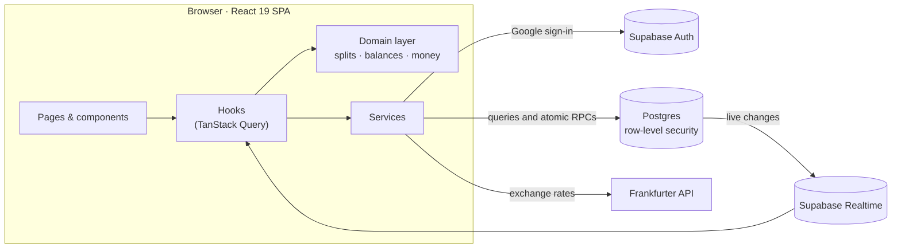

<div align="center">


# Tabby

**Split bills with friends, minus the awkward maths.**

A Splitwise-style expense tracker for friends, flatmates and trips, with real multi-currency support.<br />
Built with React 19, TypeScript and Supabase. Fork it and make it your own.

[**Live demo**](https://nikhil9182.github.io/Tabby/) · [Features](#-features) · [Quick start](#-quick-start) · [How it works](#-how-it-works) · [Use it as a base](#-use-tabby-as-a-base)

[](https://react.dev/)
[](https://www.typescriptlang.org/)
[](https://vite.dev/)
[](https://tailwindcss.com/)
[](https://supabase.com/)
[](https://vitest.dev/)

</div>

<!--
  Screenshots: drop images in docs/screenshots/ and uncomment this block.
  <p align="center">
    
    
  </p>
-->

---

## 💡 Why Tabby?

Splitting costs sounds simple until someone pays in dollars, someone else in rupees, and three people settle up a week later. Tabby keeps a running tab of **who owes whom**, and keeps the numbers right:

- **No rounding drift.** Money is stored as whole cents (or paise, or yen), and splits always add up to the exact total.
- **No currency mix-ups.** A $50 debt stays a $50 debt. Totals are converted for display, never added together raw.
- **No data leaks.** Postgres row-level security means you only ever see expenses you're part of.

---

## ✨ Features

| | |
| :--- | :--- |
| 👥 **Friends and groups** | Keep a running tab with one friend, or create a group for a trip or a flat. The two never mix. |
| 🧮 **Four ways to split** | Equally, by exact amounts, by percentage, or by shares. Leftover cents are shared out fairly. |
| 🤝 **Settle up** | Record payments, see balances update instantly, and follow suggested payments that need the fewest transfers. |
| 🌍 **Any currency** | Add expenses in any currency and see totals in yours at real exchange rates. Pay in rupees against a dollar debt, and the rate is saved with the payment. |
| 📊 **Reports** | Monthly trends, category breakdown, and personal / friends / groups split, with CSV export. |
| ⚡ **Live updates** | Expenses and payments appear on everyone's screen without a refresh. |
| 📱 **Works everywhere** | Responsive on phone and desktop, installable as an app, light and dark themes. |
| 🔐 **Private by design** | Google sign-in, and database rules that only show you your own data. |

---

## 🚀 Quick start

You'll need **Node.js 20+**, a free [Supabase](https://supabase.com) project, and a [Google Cloud](https://console.cloud.google.com) project for sign-in. It takes about 10 minutes.

### 1. Clone and install

```bash
git clone https://github.com/Nikhil9182/Tabby.git
cd Tabby
npm install
```

### 2. Create the database

In your Supabase project, open **SQL Editor** and run each file in [`supabase/migrations/`](supabase/migrations) **in order**:

| # | File | What it adds |
| :-: | :--- | :--- |
| 1 | `20261022000001_initial_schema.sql` | Tables, the new-user profile trigger, default categories |
| 2 | `20261022000002_row_level_security.sql` | Row-level security on every table |
| 3 | `20261022000003_rpc_functions.sql` | Atomic functions for groups, expenses and invitations |
| 4 | `20261022000004_splitwise_direct_expenses.sql` | Friendships and one-to-one expenses |
| 5 | `20261023000001_friend_profile_lookup.sql` | Adding friends by email |
| 6 | `20261023000002_direct_expense_rls.sql` | Access rules for friend expenses |
| 7 | `20261023000003_multi_currency.sql` | Display currency and cross-currency settlements |
| 8 | `20261023000004_schema_cleanup.sql` | Index and policy cleanup (safe to re-run) |

> Using the Supabase CLI instead? Run `supabase link` and then `supabase db push`.

### 3. Turn on Google sign-in

1. **Google Cloud Console → APIs & Services → Credentials:** create an **OAuth client ID** (Web application).
2. Add Supabase's callback URL as an **authorized redirect URI**. You'll find it under **Supabase → Authentication → Providers → Google**, and it looks like `https://<project-ref>.supabase.co/auth/v1/callback`.
3. Back in Supabase, enable the **Google** provider and paste in the client ID and secret.
4. In **Supabase → Authentication → URL Configuration**, add your app's URLs as redirect URLs:
   - `http://localhost:5173/**`
   - `https://<your-username>.github.io/<repo>/**` (for production)

### 4. Add your keys

```bash
cp .env.example .env
```

```env
VITE_SUPABASE_URL=https://your-project-id.supabase.co
VITE_SUPABASE_PUBLISHABLE_KEY=your-publishable-key
```

Both are under **Supabase → Project Settings → API**. Only use the public **publishable / anon** key; never the `service_role` key.

### 5. Run it

```bash
npm run dev
```

Open <http://localhost:5173> and sign in with Google. To confirm the database is set up, run `npm run db:inspect`.

---

## 🧠 How it works



### Engineering highlights

- **💰 Exact money maths.** Every amount is an integer in the currency's smallest unit, with per-currency precision (yen has 0 decimals, dinar has 3). Split remainders are handed out one unit at a time, so shares always add up to the total ([`src/domain/money`](src/domain/money), [`src/domain/splits`](src/domain/splits)).
- **🌐 A ledger per currency.** Balances are kept as one total per currency and are never summed across currencies. Balances shown on screen convert at the latest rate. Reports convert at each expense's own date. Cross-currency payments save their rate, so past balances never shift ([policy](ARCHITECTURE.md#81-conversion-policy)).
- **🧭 Fewer transfers.** A greedy minimum-cash-flow algorithm cuts a group's web of debts to the fewest payments, separately in each currency ([`balance-engine.ts`](src/domain/balances/balance-engine.ts)).
- **🛡️ Security in the database.** Postgres row-level security decides who can see each expense, split and payment, using `SECURITY DEFINER` helpers to avoid recursive policy checks. Friend and group data are isolated by policy, not just by the UI.
- **⚛️ Atomic writes.** An expense and its splits are saved in one database function call, so a half-saved expense can't exist.
- **🧪 Tested.** 250+ Vitest tests cover splits, balances, multi-currency rounding, rate-service failures, settlement snapshots, and components.

Want the deep dive? See [ARCHITECTURE.md](ARCHITECTURE.md).

---

## 🧱 Use Tabby as a base

Tabby is organised so you can rebrand it or build new features without fighting the codebase.

```text
src/
├── app/            # Router, providers, app shell
├── components/     # UI building blocks (ui/ = shadcn-style primitives)
├── domain/         # Pure logic, no React or network: money, splits, balances, validation
├── features/       # One folder per page: dashboard, friends, groups, expenses, reports, …
├── hooks/          # Data hooks (TanStack Query) over the services
├── lib/            # Supabase client and database types
├── services/       # Supabase, currency and exchange-rate services
└── styles/         # Tailwind theme (globals.css)
supabase/migrations # Database schema, security policies and functions
```

### Common customisations

| I want to… | Change |
| :--- | :--- |
| Rename / rebrand | `index.html` title, `public/manifest.webmanifest`, `public/favicon.svg` and the app icons, `src/components/common/tabby-icon.tsx` |
| Change colours or corner radius | CSS variables in `src/styles/globals.css` |
| Change the default categories | The seed at the end of `supabase/migrations/20261022000001_initial_schema.sql`, and the fallback list in `src/hooks/use-categories.ts` |
| Support another currency | Add it to `CURRENCY_INFO` in `src/domain/money/money.ts` (any ISO code already works, using its standard decimal places) |
| Add a page | Create `src/features/<name>/`, then register the route in `src/app/router.tsx` |
| Change the database | Add a **new** file in `supabase/migrations/`; never edit one that's already applied |

### House rules (they keep the money correct)

1. Keep amounts as integer minor units, and parse or format them with `src/domain/money`.
2. Convert currencies only through `src/services/currency`. Never multiply by a rate inside a component.
3. Every new table needs row-level security policies before the app reads it.

---

## 📜 Scripts

| Command | What it does |
| :--- | :--- |
| `npm run dev` | Start the dev server at <http://localhost:5173> |
| `npm run build` | Type-check and build to `dist/` |
| `npm run preview` | Serve the production build locally |
| `npm test` | Run the Vitest suite |
| `npm run lint` | Lint with oxlint |
| `npm run db:inspect` | Read-only check that every table exists and is reachable |
| `npm run deploy` | Build and publish to GitHub Pages |

---

## 🌍 Deploy to GitHub Pages

The app is served from `/<repo>/`, so if you fork it under a different name, first update:

- `base` in [`vite.config.ts`](vite.config.ts) (currently `/Tabby/`)
- `homepage` in [`package.json`](package.json)
- the production URL in Supabase's redirect URLs

Then choose one way to publish:

- **From your machine:** run `npm run deploy` with your `.env` in place. It builds and pushes to a `gh-pages` branch. Set **Settings → Pages → Source** to that branch.
- **From GitHub Actions:** add `VITE_SUPABASE_URL` and `VITE_SUPABASE_PUBLISHABLE_KEY` as repository secrets and set **Pages → Source** to **GitHub Actions**. [`deploy.yml`](.github/workflows/deploy.yml) then deploys on every push to `master`.

---

## 🔐 Privacy & security

- The frontend only ever holds the public Supabase key; access is enforced by row-level security in the database.
- Sign-in is Google OAuth through Supabase. Tabby never sees your password.
- There are no analytics or trackers. The full policy is in [`public/privacy.html`](public/privacy.html).

---

## 🤝 Contributing

Issues and pull requests are welcome. Some good first ideas:

- In-app account deletion
- Receipt photos on expenses
- Recurring expenses (rent, subscriptions)

Before opening a PR, please run `npm test` and `npm run build`.

---

<div align="center">

Built by [**Nikhil Bansal**](https://nikhil9182.github.io/) · [GitHub](https://github.com/Nikhil9182)

If Tabby helped you, a ⭐ helps others find it.

</div>
