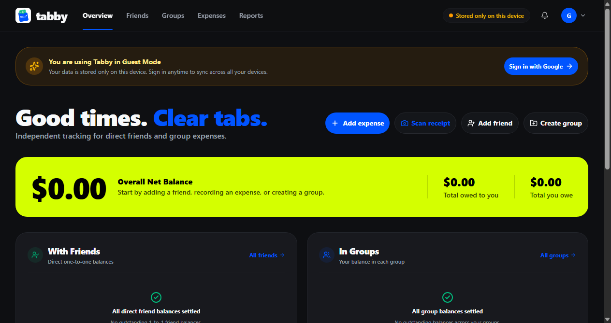
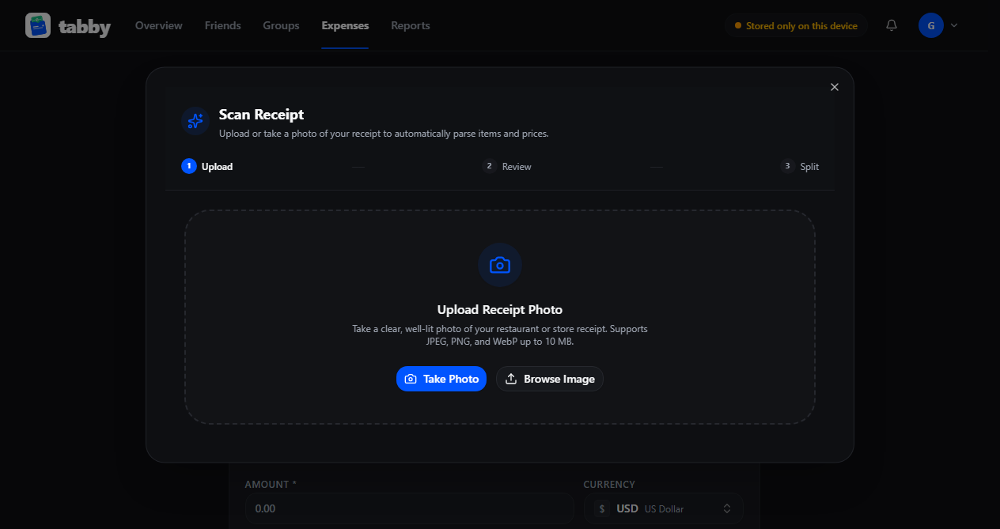
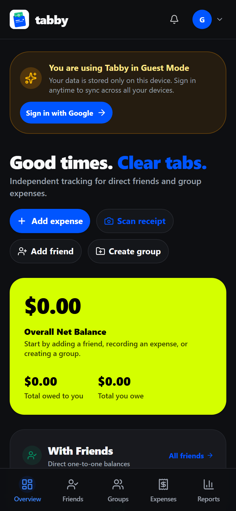
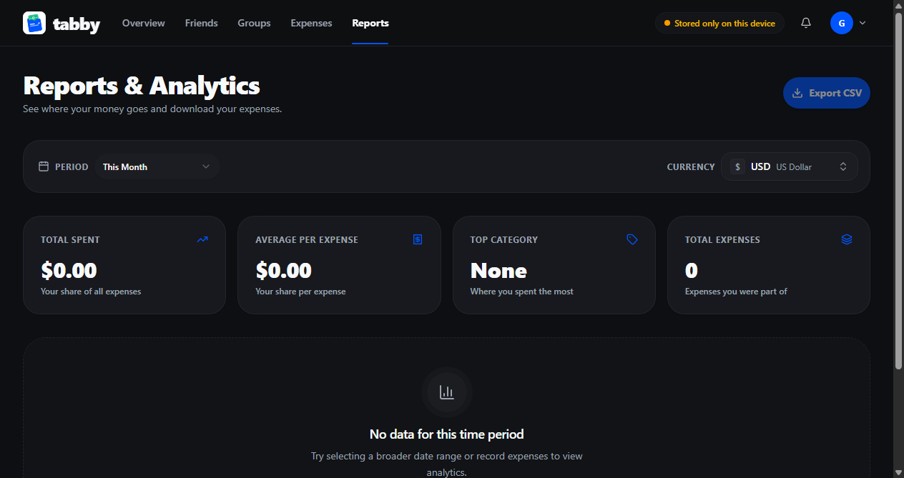
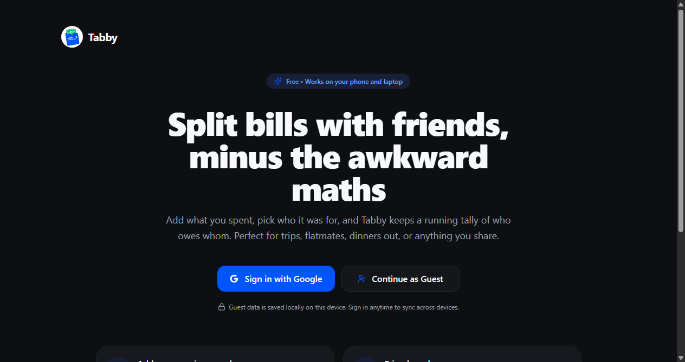
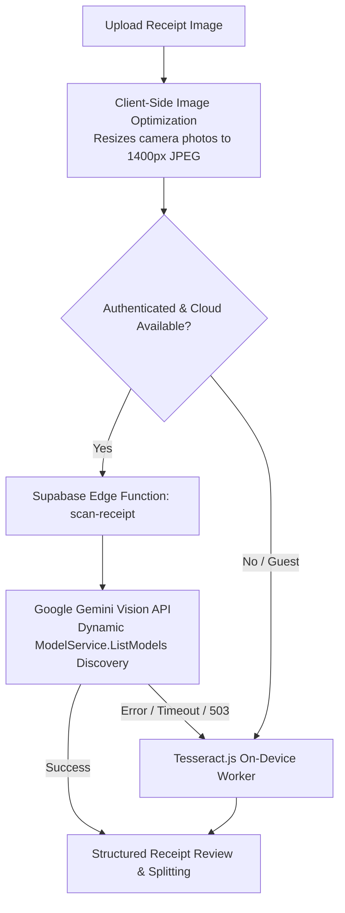
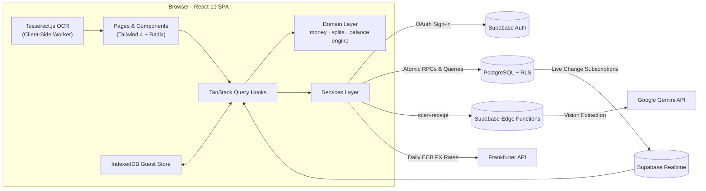

<div align="center">


# Tabby

**Split bills with friends, minus the awkward maths.**

A Splitwise-style expense tracker for friends, flatmates and trips, with real multi-currency support and dual-engine AI & on-device receipt scanning.<br />
Built with React 19, TypeScript, Tailwind CSS 4, Supabase, and Google Gemini Vision. Fork it and make it your own.

[**Live Demo**](https://nikhil9182.github.io/Tabby/) · [Features](#-features) · [Screenshots](#-screenshots) · [Quick Start](#-quick-start) · [Receipt Scanning](#-ai--local-receipt-scanning) · [How It Works](#-how-it-works) · [Architecture](#-architecture)

[](https://react.dev/)
[](https://www.typescriptlang.org/)
[](https://vite.dev/)
[](https://tailwindcss.com/)
[](https://supabase.com/)
[](https://vitest.dev/)

<br />

<p align="center">
  
</p>

</div>

---

## 💡 Why Tabby?

Splitting costs sounds simple until someone pays in dollars, someone else in rupees, three people settle up a week later, and no one wants to type in a 15-item restaurant bill. Tabby keeps a running tab of **who owes whom**, and keeps the numbers mathematically correct:

- **📸 Dual-Engine Receipt Scanning.** Cloud AI Vision extracts store names, dishes, quantities, discounts, and taxes in seconds. If offline or in guest mode, it automatically falls back to on-device Tesseract OCR.
- **💰 No Rounding Drift.** Money is stored strictly as integer minor units (cents, paise, yen). Fractions are distributed deterministically so splits always add up to the exact total down to the single penny.
- **🌐 No Currency Mix-ups.** A $50 debt stays a $50 debt. Totals are converted for display using live European Central Bank exchange rates, never added together raw.
- **⚡ Guest Mode Included.** Try the full app immediately without signing in. Data lives in local browser storage (IndexedDB) and merges into your cloud account when you sign in.
- **🛡️ Enterprise-Grade Privacy.** Postgres row-level security ensures you only ever see expenses you're directly part of. Backend Gemini credentials are never exposed to browser clients.

---

## 📸 Screenshots

<div align="center">

### Receipt Scanning & Smart Bill Splitting
*Extract restaurant receipts with AI Vision or local OCR and assign individual dishes to friends.*

<p align="center">
  
</p>

<br />

### Mobile-Ready & Visual Analytics
*Seamless responsiveness on phone and desktop, plus detailed breakdown of monthly spending trends.*

| 📱 Mobile-First Experience | 📊 Spending Reports & Analytics |
| :---: | :---: |
|  |  |

<br />

### Instant Onboarding
*Jump straight in with Guest Mode or sign in with Google OAuth.*

<p align="center">
  
</p>

</div>

---

## ✨ Features

| | |
| :--- | :--- |
| 📸 **AI & Local Receipt Scanner** | Take a photo or upload a receipt. AI Vision securely extracts items, prices, discounts, and taxes with seamless offline Local OCR fallback. |
| 🧮 **Smart Bill Splitting** | Split bills equally, by exact amounts, by percentage, by shares, or assign individual receipt dishes to specific friends with proportional tax and discount allocation. |
| 👤 **Guest Mode** | Test and use Tabby with zero signup. Data persists in browser IndexedDB and smoothly merges with your account when you sign in with Google. |
| 👥 **Friends & Groups** | Keep a continuous tab with one friend, or create groups for road trips, flatmates, or holidays. Group and direct balances never cross-contaminate. |
| 🤝 **Simplified Debt Settlement** | Record payments, see balances update instantly, and follow smart suggestions using a greedy cash-flow algorithm that requires the fewest transfers. |
| 🌍 **True Multi-Currency** | Add expenses in any currency and see balances converted at real-time exchange rates. Settle a USD debt in INR with rate snapshots locked at payment time. |
| 📊 **Reports & CSV Export** | Monthly trends, category breakdowns, and friend/group split distributions with one-click CSV export. |
| ⚡ **Realtime Sync** | Multi-device sync powered by Supabase Realtime—new expenses and settlements appear instantly without page reloads. |
| 📱 **Installable PWA** | Works offline and installs as a progressive web app on iOS, Android, macOS, and Windows. |
| 🔐 **Row-Level Security** | Enforced at the Postgres database layer. No user can read, insert, or alter an expense they are not an explicit participant of. |

---

## 🔍 AI & Local Receipt Scanning

Tabby uses a resilient **hybrid receipt-processing pipeline**:



1. **Client-Side Image Optimization**: Camera photos (often 5MB–12MB) are automatically resized to 1400px before uploading, cutting bandwidth by 97% and reducing AI processing time from 60+ seconds to 1–2 seconds.
2. **Server-Side Security**: The `GEMINI_API_KEY` is stored **strictly in Supabase Edge Secrets** and is never leaked to client bundles, local storage, or Git.
3. **Dynamic Model Discovery**: The Edge Function dynamically discovers available Gemini models via Google's `ModelService.ListModels` API, prioritizing modern flash models without breaking when Google updates model aliases.
4. **Automatic Silent Fallback**: If cloud AI is busy, reaches high demand, or times out, Tabby automatically runs local on-device OCR (Tesseract.js) without disturbing the user with error popups.
5. **Smart Discount & Tax Handling**: Distinguishes negative discounts (`-10.00`, promos, vouchers), taxes, and tips, ensuring items and bill totals reconcile with a one-click discrepancy resolver.

---

## 🚀 Quick Start

You'll need **Node.js 20+**, a free [Supabase](https://supabase.com) project, and a [Google Cloud](https://console.cloud.google.com) project for OAuth sign-in. It takes about 10 minutes.

### 1. Clone and install

```bash
git clone https://github.com/Nikhil9182/Tabby.git
cd Tabby
npm install
```

### 2. Set up the database

In your Supabase project, open the **SQL Editor** and run each migration in [`supabase/migrations/`](supabase/migrations) **in numerical order**:

| # | Migration File | Description |
| :-: | :--- | :--- |
| 1 | `20261022000001_initial_schema.sql` | Core schema, user profile trigger, default categories |
| 2 | `20261022000002_row_level_security.sql` | Postgres Row-Level Security policies on all tables |
| 3 | `20261022000003_rpc_functions.sql` | Atomic RPC functions for groups and expense creation |
| 4 | `20261022000004_splitwise_direct_expenses.sql` | Friendships and one-to-one direct balances |
| 5 | `20261023000001_friend_profile_lookup.sql` | Secure profile lookup for adding friends by email |
| 6 | `20261023000002_direct_expense_rls.sql` | Direct expense access controls |
| 7 | `20261023000003_multi_currency.sql` | Multi-currency storage, preference and settlement rate locking |
| 8 | `20261023000004_schema_cleanup.sql` | Index optimization and policy cleanup |

> 💡 **Using the Supabase CLI?** Simply run `supabase link` followed by `supabase db push`.

### 3. Deploy the AI Receipt Scanner (Supabase Edge Function)

Configure your Google Gemini API key as a secure secret in Supabase and deploy the function:

```bash
# 1. Set your Gemini API key in Supabase Edge Secrets
npx supabase secrets set GEMINI_API_KEY="your-gemini-api-key" --project-ref your-project-ref

# 2. Deploy the scan-receipt Edge Function
npx supabase functions deploy scan-receipt --project-ref your-project-ref --no-verify-jwt
```

### 4. Configure Google OAuth

1. Go to **Google Cloud Console → APIs & Services → Credentials** and create an **OAuth Client ID** (Web Application).
2. Add Supabase's redirect URI (from **Supabase → Authentication → Providers → Google**, e.g., `https://<project-ref>.supabase.co/auth/v1/callback`) to **Authorized redirect URIs**.
3. In Supabase, enable **Google** provider and enter your Client ID and Client Secret.
4. Under **Supabase → Authentication → URL Configuration**, add redirect URLs:
   - `http://localhost:5173/**` (development)
   - `https://<your-username>.github.io/<repo>/**` (production)

### 5. Configure environment variables

```bash
cp .env.example .env
```

```env
VITE_SUPABASE_URL=https://your-project-id.supabase.co
VITE_SUPABASE_PUBLISHABLE_KEY=your-publishable-anon-key
```

### 6. Launch the development server

```bash
npm run dev
```

Open <http://localhost:5173> and click **Continue as Guest** or sign in with Google. Run `npm run db:inspect` anytime to verify your database connectivity.

---

## 🧠 How It Works



### 🔬 Engineering Highlights

- **💰 Integer Minor Unit Math:** Every monetary calculation is strictly integer-based (cents, paise, yen). Fractions and remainders are allocated deterministically using largest-remainder distribution, ensuring zero-drift splits ([`src/domain/money`](src/domain/money), [`src/domain/splits`](src/domain/splits)).
- **📸 Hybrid Vision & Local OCR:** Fast multimodal AI vision running through Supabase Edge Functions with zero client credentials, with automatic fallback to client-side Tesseract.js.
- **🌐 Dual-Ledger Currency Policy:** Balances are tracked per currency independently. Cross-currency debts snapshot exchange rates at the moment of payment to protect historical records from fluctuating exchange rates ([policy doc](ARCHITECTURE.md#81-conversion-policy)).
- **🧭 Greedy Debt Simplification:** Reduces a tangled web of group debts to the minimum number of transactions using a graph cash-flow algorithm ([`balance-engine.ts`](src/domain/balances/balance-engine.ts)).
- **🧪 332 Passing Tests:** Comprehensive Vitest test suite covering multi-currency edge cases, settlement snapshots, receipt parsing heuristics, and guest data migrations.

---

## 🧱 Codebase Structure

```text
src/
├── app/            # App shell, router definitions, global providers
├── components/     # UI building blocks (ui/ = primitives, receipts/ = scanner modal)
├── domain/         # Pure business logic: money math, receipt parser, splits, balances
├── features/       # Feature pages: dashboard, expenses, friends, groups, reports, settings
├── hooks/          # Data hooks powered by TanStack Query
├── lib/            # Supabase client, database types, utility helpers
├── services/       # OCR service, AI Vision service, Supabase adapters, Frankfurter FX
└── styles/         # Tailwind CSS v4 design tokens and theme variables
supabase/
├── functions/      # Server-side Deno Edge Functions (scan-receipt)
└── migrations/     # Production SQL schema migrations, RLS policies, and RPCs
```

---

## 📜 Available Scripts

| Command | Description |
| :--- | :--- |
| `npm run dev` | Start local Vite development server at <http://localhost:5173> |
| `npm run build` | Type-check TypeScript and build production bundle to `dist/` |
| `npm test` | Run all 332 Vitest unit and integration tests |
| `npm run lint` | Run fast static code analysis with oxlint |
| `npm run preview` | Preview production build locally |
| `npm run db:inspect` | Inspect Supabase database tables and RLS status |
| `npm run deploy` | Build and deploy directly to GitHub Pages |

---

## 🔐 Privacy & Security

- All database access is gated by Postgres Row-Level Security policies; the client only holds the public anon key.
- Authentication uses Google OAuth through Supabase; Tabby never collects or stores passwords.
- Server-side Gemini API credentials remain strictly confined to Supabase Secrets; zero API keys are bundled or stored in the browser.
- Receipt images processed with local OCR run entirely on your device in browser memory.
- Zero tracking or analytics cookies. Full policy available in [`public/privacy.html`](public/privacy.html).

---

<div align="center">

Built with care by [**Nikhil Bansal**](https://nikhil9182.github.io/) · [GitHub](https://github.com/Nikhil9182)

If Tabby helped simplify your shared expenses, consider giving it a ⭐!

</div>
